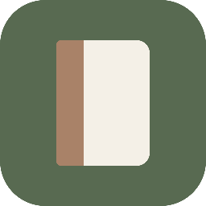

# 应用图标

「书页之间」的 Windows 桌面应用图标。

**状态：设计已完成，并已接入应用**（2026-09-28，v1.0.1）。exe 与窗口都使用
`final/icon.ico`，打包产物不再沿用 Electron 默认图标。接入方式与实际改动见文末，
完整记录见 `docs/changes/2026-09-28-应用图标接入.md`。

本目录是**设计资产与一次性生成工具**，不参与应用构建流程 —— 构建只取 `final/icon.ico`
这一个文件。

---

## 设计语言从哪来

图标不是单独设计的，先读了 `src/styles.css` 与界面文案，从现有 UI 里取出这套语言：

| 项 | 界面里的值 | 图标怎么用 |
|---|---|---|
| 主色 | `#586a51` 主按钮、提示条 | 底色 |
| 纸色 | `#f1ede4` 默认主题暖纸底 → `#fffdf8` 主按钮文字 | 书身 `#f4f0e7`（两者之间） |
| 字体气质 | 全站衬线 `"Noto Serif SC", "SimSun", serif` | 决定整体走安静、书卷气，不做科技感切角 |
| 圆角 | 3 / 4 / 5 / 6 / 8 px 的小圆角 | 外框 56/256 ≈ 22%，书页 14/256 |
| 书脊母题 | `.book-spine` 的 `border-radius: 3px 6px 6px 3px` 与四色书脊 | 方案 A 直接引用；暖褐 `#a98268` 取自书脊 tone-1 |
| 应用名 | 「书页之间」 | 方案 B 的立意来源 |

**明确避开的**：渐变、高光、投影、立体厚度、字母与汉字、细碎纹理。这些都会在 16×16 上糊掉，
也与界面本身「安静、专注阅读」的气质不符。

---

## 三个方案

### 方案 A · 极简书脊型



- **核心**：一本合起的书，正面直视。左侧书脊用暖褐 `#a98268`，与纸色书身拉开明度差。
- **元素含义**：左侧小圆角 + 右大圆角，直接引用界面里 `.book-spine` 的不对称圆角；
  暖褐取自界面四色书脊的 tone-1，所以图标与书架上的书是同一套色。
- **为什么合适**：最安静、最克制，像一本放在桌上的书。缩到 16×16 是「奶油块 + 左侧棕条」，
  仍然立得住。
- **弱点**：它说的是「书 / 笔记本」，不是「在读书」。辨识度够，但**气质上最接近办公文具**。

### 方案 B · 打开的书型 ★ 采用


- **核心**：一本摊开的书。书页自左右两侧向中缝下沉，中缝是一条底色竖线。
- **元素含义**：**书页之间**——两页之间的那道缝就是应用名本身。上缘中间下凹是书页落进
  订口的样子，不是装饰。
- **配色**：底色 `#586a51`，书身 `#f4f0e7`，只用一个色相、两个明度，没有第三个颜色。
- **为什么合适**：「阅读」这件事本身，而不是「一本书」这个物件。左右对称、视觉重心稳、
  轮廓简单，缩小时先丢掉的是中缝那条线，整体收拢成一块完整的书，**16×16 下顶部凹口仍在**。

### 方案 C · 书签型


- **核心**：一本书，一条暖褐书签带从上方垂入，偏右打破对称。
- **元素含义**：书签 = 阅读进度，指向这个应用"记住你读到哪"的核心能力。
- **为什么合适**：**大尺寸下辨识度最高**，几乎不需要解释。
- **弱点**：书签是阅读类应用的常见套路，谈不上独特；而且 24×24 以下书签会糊成一个棕点，
  **小尺寸表现是三个方案里最差的**。

---

## 为什么选 B

按需求里给的几条硬标准逐条比：

| 标准 | A 书脊 | B 打开的书 | C 书签 |
|---|---|---|---|
| 简洁、无多余装饰 | ✅ | ✅（只有两个元素） | ⚠️ 三个色块 |
| 一眼联想到阅读 | ⚠️ 联想到"书/笔记本" | ✅ | ✅ |
| 缩小后仍清晰 | ✅ | ✅ **16px 仍有结构** | ❌ 24px 起糊 |
| 与现有 UI 统一 | ✅ | ✅ | ✅ |
| 不像办公/文件类通用图标 | ❌ 偏笔记本 | ✅ | ⚠️ 偏通用阅读 App |
| 与项目定位的关联 | 弱 | **强（就是应用名）** | 中 |

B 是唯一一个**在 16×16 下仍然保留可辨认结构**、同时又不靠装饰取胜的方案。
A 更安静但容易读成笔记本，C 更醒目但小尺寸最弱且套路化。

**对 B 的诚实保留**：「绿底 + 白色打开的书」本身是阅读类应用最常见的图标原型之一。
这个方案的身份感来自具体做法——书页向中缝下沉的弧度、单一色相、以及那道中缝，
而不是来自原型本身。如果之后觉得辨识度不够，最直接的加强方向是换底色而不是加元素。

---

## 定稿


与方案 B 的差别只有一处：中缝宽度 8 → 9px，让它在 64、128 两个尺寸下更确定。

几何（256×256 画布内）：

- 外框：圆角矩形，半径 56
- 书体：`x 50–210, y 66–196`，四角半径 14，上缘两段二次曲线在中缝处下沉 28px
- 中缝：`x=128` 的竖线，宽 9，从上缘凹口落到下缘

---

## 资产

```
final/
  icon.svg          定稿矢量源文件（可编辑，256 viewBox）
  icon.ico          Windows 多尺寸图标，7 项：16/24/32/48/64/128/256
  png/icon/*.png    定稿各尺寸 PNG
concepts/*.svg      三个方案的矢量源文件
png/<方案>/*.png     三个方案各尺寸 PNG
preview/
  contact-sheet.png 三个方案 + 定稿的对比图，浅底与深底各一行
  from-ico.png      从 icon.ico 回读出来的 256 图，用于确认 ICO 没写坏
tools/              生成脚本，一次性设计工具，不参与应用构建
```

`.ico` 用的是 Vista 之后的 PNG 内嵌写法，不做 BMP/DIB 转换；已回读校验目录项与数据偏移。
`design/` 不在 `.gitignore` 的忽略范围内（那四条规则都锚定在仓库根目录）。

## 重新生成

本机没有 ImageMagick（`convert` 是 Windows 自带的文件系统工具，不是它）、
Inkscape、rsvg-convert，python 侧也没有 Pillow，所以栅格化复用项目已有的 Electron，
**没有引入任何新依赖**。

```bash
npx electron design/app-icon/tools/render.mjs        # SVG → 各尺寸 PNG
node design/app-icon/tools/build-ico.mjs             # PNG → icon.ico
npx electron design/app-icon/tools/contact-sheet.mjs # 生成对比图
```

## 接入方式（已于 2026-09-28 执行）

**没有走 electron-builder 默认的图标查找路径 `build/icon.ico`** —— `/build/` 在 `.gitignore`
里（第 9 行，锚定仓库根目录），把图标放进那里会被静默排除在上传之外。改用显式路径，
`.gitignore` 无需改动。

实际改动三处：

| 位置 | 值 | 作用 |
|---|---|---|
| `package.json` → `build.win.icon` | `design/app-icon/final/icon.ico` | **构建期**读取，把图标嵌进 exe 资源段 |
| `package.json` → `build.files` | 增加 `design/app-icon/final/icon.ico` | 让 `.ico` 真的进 `app.asar` |
| `electron/main.js` → `BrowserWindow.icon` | `path.join(__dirname, '..', 'design', 'app-icon', 'final', 'icon.ico')` | **运行时**读取，窗口自身图标 |

⚠️ **第二行是最容易漏的。** `BrowserWindow.icon` 是运行时读取，文件不在 asar 里就读不到；
漏掉的表现是**开发态图标正常、打包后退回默认图标，而且构建过程一声不吭**。

路径用 `__dirname` 回溯而不是写死绝对路径：开发态 `__dirname` 是仓库的 `electron/`，
打包态是 `app.asar/electron/`，该相对位置两边都成立，**同一个表达式通用，图标只保留一份**。

exe 图标是否真的换掉了，可以通过解析 PE 资源段的 `RT_GROUP_ICON` 逐项比对来确认，
方法记录在 `docs/changes/2026-09-28-应用图标接入.md`。
